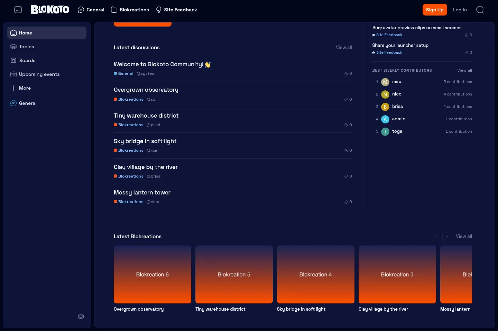

# Blokoto Community Theme

A restrained Discourse theme for the Blokoto community. One surface, one
purpose: get people into current discussions, with a quiet rail for what the
community is doing next and a carousel for what they have made.





## Design contract

- **One homepage surface.** A compact introduction, a single latest-discussion
  list, a right rail for the next events, hot topics, and the week's best
  contributors, and a full-width Blokreations strip below them. No category
  grid, featured section, CTA card, or second feed.
- **The rail is utility, not a second feed.** Three compact blocks sit in one
  column, separated by hairlines. They surface what is happening, not another
  chronological list.
- **Two columns inside the surface.** On `xl` and up the discussion column and
  the rail share the surface, divided by one vertical hairline. Below `xl` the
  rail stacks under the discussions.
- **Blokreations below the columns.** A full-width strip of image cards from a
  configured category spans both columns under the discussion list and rail. It
  is a native scroll-snap carousel: one image per latest topic, title below, and
  labelled arrow controls. No external carousel library.
- **Full-width islands.** The main surface, sidebar, and header span the available
  width with no `max-width` cap. Every island uses the same 8px outer margin and
  8px gap; the header uses that margin but no gap, so the islands sit flush under
  it.
- **Frontend corner language.** Every island uses a 12px radius, matching the
  Frontend's `rounded-xl` surfaces.
- **Centered content inside the full-width shell.** The main island keeps its
  full-width background and border; its content is capped at `80rem` and centered
  with `margin-inline: auto`.
- **The page never scrolls.** `html`/`body` are viewport-height and locked. The main
  island and the sidebar are independent scroll containers; the page chrome stays
  put.
- **Transparent, borderless navbar.** The header is navigation only: no fill, no
  border, no card, and **56px tall** to match the Frontend's `h-14` navbar. Its
  content runs edge to edge on the islands' 8px margin, and it stays above the
  scrollable main island with no gap between them.
- **Content before chrome.** No gradients, nested cards, icon/heading/text tiles,
  or decorative stat blocks. Hierarchy comes from type, spacing, and one rule
  between sections.
- **Categories are primary navigation.** The categories sit in the header as a
  compact nav: 36px links, 20px category icons, 14px bold labels, a 5% hover
  wash, and a filled orange current item. They follow the user's sidebar category
  order and are never repeated in the sidebar. Tags never appear in the sidebar.
- **Sidebar as navigation.** One quiet island of 36px rows and 20px line icons.
  Home leads the primary group (Home, Topics, Boards, More) as a normal row, not
  a separate button. Hover is a 5% wash; the current destination gets a 12%
  surface, a semibold label, and an accent icon, so a header category link is the
  only orange fill besides the primary action. Section labels are 11px uppercase;
  labelled sections are separated by space, and unlabelled chat sections keep a
  single hairline that runs edge to edge across the sidebar.
- **Frontend palette.** The page canvas is Blokoto-950 in dark and Blokoto-50 in
  light. Islands are Blokoto-900/white, borders Blokoto-800/#e2e8f0, muted text
  follows the Frontend's muted-foreground, and the primary action uses the
  Frontend orange.
- **Blokoto's world, kept.** A subtle tile grid, Space Grotesk type, and the
  Blokoto wordmark.
- **One primary action.** "Start a discussion" plus a quiet "Browse categories"
  link. Each list and rail section has a quiet "View all" link of its own.

## What is included

### Homepage

One block renders the custom homepage and its rail:

| Section | Purpose |
| --- | --- |
| `theme:blokoto:home` | Compact intro, one primary action, and a latest-discussion list with category, author, and reply count. |
| Next events (rail) | Next and ongoing events from the Discourse Events plugin, with date, time, and a "Happening now" marker. |
| Hot topics (rail) | The core `hot` topic list, with category and reply count. |
| Best weekly contributors (rail) | The weekly user directory ranked by posts plus topics, with rank, avatar, and contribution count. |
| Latest Blokreations (full-width) | A horizontal carousel of the latest topics in the configured Blokreations category, one card per topic with a first-post image. |

The home block owns loading, empty, and error states. It fetches `latest`
through the normal Discourse topic-list store and respects the configured item
count. The rail is rendered by three small components under
`javascripts/discourse/components/`; each owns its own loading, empty, and error
state.

The events block is only rendered when the `discourse-events` plugin is enabled
(`discourse_events_enabled` and `discourse_post_event_enabled`). The contributors
block is only rendered when the user directory is enabled and profiles are
visible to the current user. The hot-topics block uses the core `hot` filter and
needs no plugin.

The Blokreations strip reads `homepage_blokreations_category` through the normal
category latest topic list. It keeps topics with a first-post image, skips the
rest, and hides itself when the category slug is blank or the category cannot be
found. Its arrows are progressive enhancement; the track is natively scrollable
and keyboard-focusable.

### Category pages

`theme:blokoto:category-heading` supplies the visible category title and
description above Discourse's normal navigation and topic table. It is plain
type — no banner, card, or extra panel. The list-page category picker is hidden;
categories are already primary navigation in the header, so the filter row keeps
only the tag picker.

### Header navigation

The `category-nav` initializer renders `BlokotoCategoryNav` into the header's
`before-header-panel` outlet, after the wordmark and before the header actions.
Entries use Solar symbols directly from the Solar Icons sprite: General uses a
chat bubble, Site Feedback a lightbulb, Staff a shield-user, and every other
category falls back to a folder. A category configured with an icon in Discourse
keeps that icon, which the Solar Icons component maps to its Solar equivalent.
At rest the symbol is linear; the current category uses the bold symbol. The
entries follow `sidebar_category_ids`; without an explicit order they fall back
to the top five site categories. Entries are hidden below `lg` so the header
actions keep their room.

The map lives in `SOLAR_CATEGORY_ICONS` in the component. The Solar Icons
component inlines its sprite, so the `si-*` symbols do not need entries in
`about.json`'s `svg_icons`.

### Sidebar

Community navigation and chat only. Categories live in the header, and the tags
section is never shown. Home is the first row of the primary group, followed by
Topics, Boards, and More. Rows are 36px with 20px line icons, hover is a soft
wash, and the active row is a quiet raised surface with a semibold label and an
accent icon. Row padding is 8px inside the 12px list inset, matching the Frontend
friends rail. The chat channels section has no header and is forced expanded, so
its entries are always visible. Chat sections are separated by a hairline that
spans the full sidebar width, ignoring the row insets.

### Settings

| Setting | Default | Notes |
| --- | --- | --- |
| `homepage_latest_count` | `6` | 1–12 discussions on the homepage. |
| `homepage_events_count` | `3` | 1–6 next events in the rail. |
| `homepage_hot_count` | `4` | 1–8 hot topics in the rail. |
| `homepage_contributors_count` | `5` | 1–10 weekly contributors in the rail. |
| `homepage_blokreations_category` | `blokreations` | Category slug; blank hides the strip. Use `parent/child` for subcategories. |
| `homepage_blokreations_count` | `8` | 1–16 Blokreation cards. |
| `homepage_primary_url` | `/new-topic` | Primary action destination. |
| `homepage_secondary_url` | `/categories` | Secondary link destination. |

## Layout rules

- `--space-2` (8px) is the outer margin and the gap between every island. The
  navbar shares the margin but has no gap below it, so the islands start at its
  bottom edge.
- `max-width` is removed from both `#main-outlet-wrapper` and the header `.wrap`;
  at 1919px the main island is 1903px wide. The header also drops Discourse's
  header padding (`--d-header-padding-x: 0`), so its content starts at the same
  8px margin as the islands.
- `--t-Blokoto-radius` is `0.75rem` (12px) and is shared by the main island,
  homepage surface, sidebar, and topic list.
- `--t-Blokoto-content-width` is `80rem`. The homepage layout uses it directly;
  core pages get the same width through symmetric island padding.
- The homepage layout is a two-column grid: a fluid discussion column and a
  `15–19rem` rail, with a clamped column gap. It is capped at `80rem` and centred.
- The rail keeps a 1px inline-start rule on `xl` and up. Below `xl` it drops the
  rule and stacks under the discussions with a top rule.
- Rail sections are separated by one hairline and 16px vertical padding. Labels
  are 11px uppercase; rows are type-and-spacing only, with no nested cards,
  tiles, or shadows. Event rows use a two-line date marker instead of a badge.
- Rail loading uses the same pulse skeleton as the latest list; empty and error
  states stay inside their section.
- The Blokreations strip spans both homepage columns below the main/rail row. It
  uses the same `80rem` content width and its own top rule.
- The carousel is a native horizontal scroll-snap track with hidden scrollbars,
  4:3 media, an 8px media radius, and titles below the image. There is no card
  chrome around each item.
- The previous/next buttons scroll by 80% of the track width and disable at the
  ends; the track itself is focusable and scrolls with the keyboard.
- `html`, `body`, and `#main-outlet-wrapper` are locked to `100dvh`; the body has
  `overflow: hidden`.
- The main island is `overflow-y: auto`; the homepage uses the same rule on
  `.blokoto-home`. The sidebar scrolls independently.
- The header is `position: relative` with a transparent background and no border.
- `--t-Blokoto-header-height` is `3.5rem` (56px) on desktop and mobile, matching
  the Frontend navbar; the islands begin at its bottom edge with no gap.
- The wordmark box follows the logo SVG's aspect ratio, so the mask does not
  reserve dead space. The sidebar toggle, wordmark, and category nav share the
  same 16px box gap, which reads as an even optical gap.
- The sidebar toggle uses the Solar `sidebar` symbol from the Solar Icons
  component.
- The category nav is `36px` tall, uses `20px` icons, and is hidden below `lg`.
- The sidebar has no horizontal padding; row insets come from the link wrappers.
  That lets the chat separators cross the full sidebar width. Rows use 8px
  horizontal padding (`px-2`) and a 6px icon gap, matching the Frontend friends
  rail; the list inset is 12px (`px-3`).
- The homepage keeps the sidebar visible. Its single surface sits in the content
  column; the intro is a single editorial column (headline, subtitle, actions)
  because the rail takes the right side, and it stays single-column on mobile.
- The discussion column and the rail are one surface, not two islands. The rail
  has no independent scroll; the homepage surface scrolls as a whole.
- The sidebar and the homepage surface are independent islands in the same
  grid, each with its own scroll container.
- On mobile, category topic rows collapse to title plus tags inside one scrollable
  island; table columns, avatars, and activity are removed rather than squeezed.
- The latest list is not a card grid: rows are separated by a 1px rule inside the
  one surface.
- The sidebar and main content share the same width system and gap as the
  homepage.
- Discourse's optional welcome banner is hidden; its title/search repeats the
  header and the first discussion.

## Building on it

```text
about.json
settings.yml
locales/{en,pt_BR,es}.yml
assets/                         Space Grotesk, wordmark, grid tile
common/common.scss              imports only
stylesheets/
  brand/                        fonts and color tokens
  app/                          base, header, category nav, sidebar, topic list
  blocks/                       homepage (with rail and Blokreations) and category heading
  layouts/                      homepage composition
javascripts/discourse/
  api-initializers/             one file per extension point
  blocks/                       block components
  components/                   header category navigation, homepage rail blocks, and carousel
  lib/                          event date formatting
spec/system/                    homepage and category heading specs
```

The theme is a full theme (not a component) with `custom_homepage` enabled. It
defines Blokoto Light and Dark color schemes and uses only Space Grotesk, loaded
locally.

## Local development

The theme was built and verified against a local Discourse 2026.11 Docker
instance.

```bash
gem install discourse_theme

export DISCOURSE_URL=http://localhost:8081
export DISCOURSE_API_KEY=your_admin_api_key

discourse_theme watch DiscourseTheme
```

On first sync, `watch` offers to create the theme. After it is created, make it
the active/default theme under **Admin → Customize → Themes**. The custom
homepage activates through the `custom_homepage` modifier; there is no page
template override.

```bash
# after the theme id is stored by watch
discourse_theme upload DiscourseTheme

# JS, SCSS, formatting, and types
pnpm install
pnpm lint
```

### Local Docker notes

The local instance needs PostgreSQL with `pg_trgm`, `hstore`, and `vector`, plus
Redis. The official `discourse/discourse` image works with a
`pgvector/pgvector:pg16` database; let Discourse run migrations. Do not mount an
empty named volume over `/var/www/discourse/public/assets`.

The rail's events block needs the `discourse-events` plugin with both
`discourse_events_enabled` and `discourse_post_event_enabled` on. Without them
the block is hidden. The contributors block uses the core user directory
(`enable_user_directory`) and is hidden when the directory is off or profiles
are hidden from the current user.

## Accessibility

- The palette mirrors the Frontend's Blokoto tokens in both schemes. Body and
  muted text keep the Frontend's contrast; the primary action uses the Frontend
  orange with Blokoto-50 labels.
- The homepage intro and list use real heading levels and a named list.
- The rail is an `aside` with a translated label; each block is a named
  `section`, and events use `<time>` with a machine-readable `datetime`.
- The Blokreations strip is a named section whose track is a labelled, focusable
  list; the arrow buttons have names, and card images are decorative because the
  card title names the link.
- Rail rows keep their links in the accessibility tree; avatars are decorative
  next to the linked contributor name.
- Loading uses a reserved-space skeleton; empty and error states are explicit.
- Keyboard focus rings, selection, scrollbars, and reduced-motion behavior are
  styled from the same palette.
- Decorative grid and wordmark are CSS-only; the wordmark keeps the site title in
  the accessibility tree.

## Notes

- Space Grotesk is a deliberate product/brand choice taken from the existing
  Frontend. Impeccable's detector flags it as an overused font; the brand
  commitment wins here.
- The header wordmark is a color-scheme-tinted CSS mask of
  `assets/blokoto-logo-white.svg`. Its box follows the SVG's aspect ratio so the
  mask does not leave dead space. Replace the asset if the mark changes.
- Fresh installs show the latest list immediately; no tags or categories need to
  be configured first.
- The rail degrades on its own: hot topics only need core Discourse, events
  appear when the events plugin is on, and contributors appear when the directory
  is available. Empty rail blocks say so rather than disappearing.
- The Blokreations strip uses the topic's first-post image (`image_url`), so
  topics whose image lives only in a reply are skipped. It needs no plugin; set
  the category slug to change the source.
