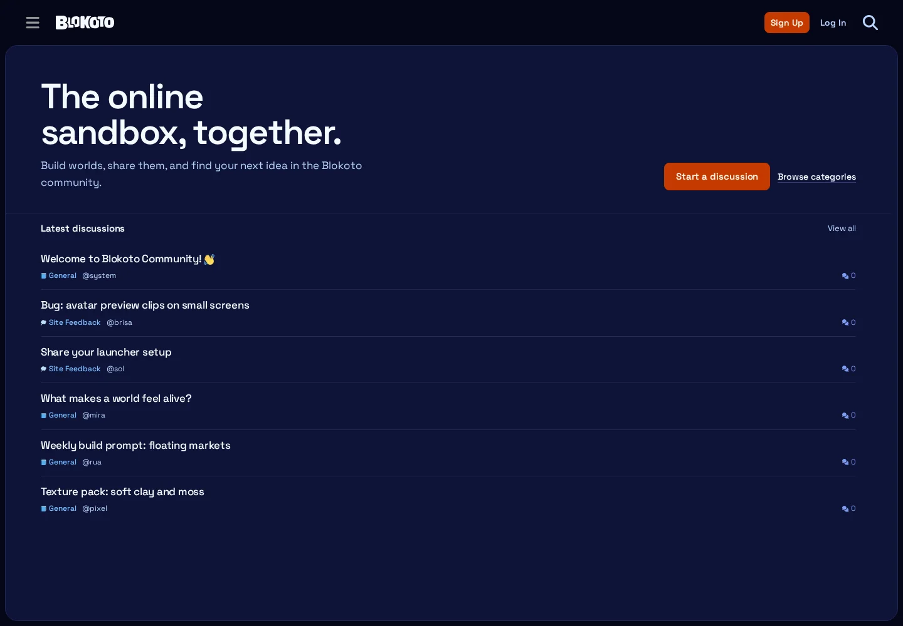
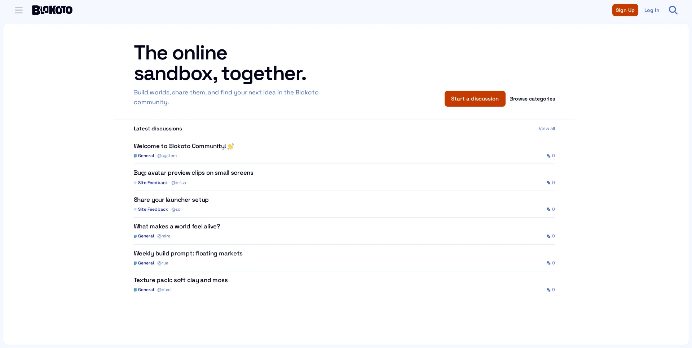
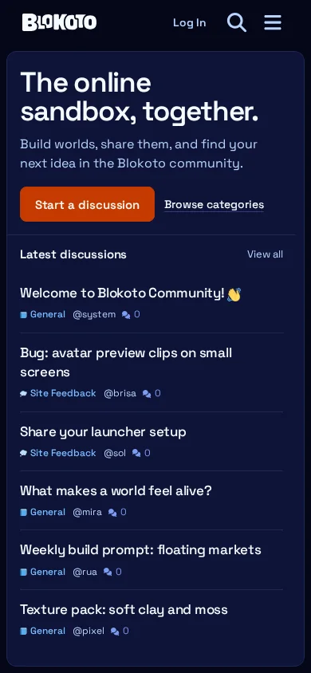
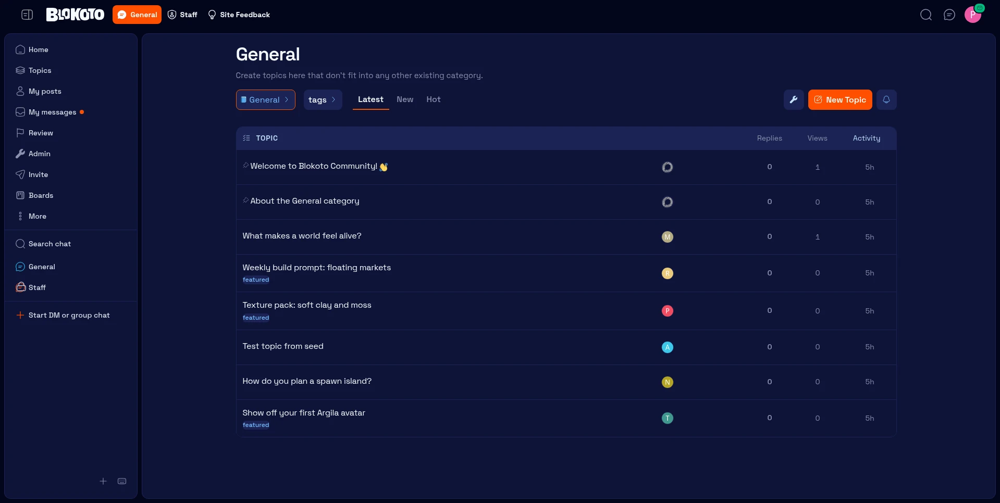

# Blokoto Community Theme

A restrained Discourse theme for the Blokoto community. One surface, one
purpose: get people into current discussions.









## Design contract

- **One homepage surface.** A compact introduction and a single latest-discussion
  list. No category grid, featured section, link panel, CTA card, or second feed.
- **Full-width islands.** The main surface, sidebar, and header span the available
  width with no `max-width` cap. Every island uses the same 8px outer margin and
  8px gap.
- **Frontend corner language.** Every island uses a 12px radius, matching the
  Frontend's `rounded-xl` surfaces.
- **Centered content inside the full-width shell.** The main island keeps its
  full-width background and border; its content is capped at `80rem` and centered
  with `margin-inline: auto`.
- **The page never scrolls.** `html`/`body` are viewport-height and locked. The main
  island and the sidebar are independent scroll containers; the page chrome stays
  put.
- **Transparent, borderless navbar.** The header is navigation only: no fill, no
  border, no card. It stays above the scrollable main island, so it never sits over
  moving content with a see-through background.
- **Content before chrome.** No gradients, nested cards, icon/heading/text tiles,
  or decorative stat blocks. Hierarchy comes from type, spacing, and one rule
  between sections.
- **Blokoto's world, kept.** Deep indigo surfaces, a subtle tile grid, warm orange
  for the primary action and links, Space Grotesk type, and the Blokoto wordmark.
- **One primary action.** "Start a discussion" plus a quiet "Browse categories"
  link. The latest list has one secondary "View all" link.

## What is included

### Homepage

One block renders the whole custom homepage:

| Block | Purpose |
| --- | --- |
| `theme:blokoto:home` | Compact intro, one primary action, and a latest-discussion list with category, author, and reply count. |

The block owns loading, empty, and error states. It fetches `latest` through the
normal Discourse topic-list store and respects the configured item count.

### Category pages

`theme:blokoto:category-heading` supplies the visible category title and
description above Discourse's normal navigation and topic table. It is plain
type — no banner, card, or extra panel.

### Sidebar

`theme:blokoto:home-link` adds a single "Community home" entry back to the custom
homepage. The rest of the sidebar is Discourse's normal navigation.

### Settings

| Setting | Default | Notes |
| --- | --- | --- |
| `homepage_latest_count` | `6` | 1–12 discussions on the homepage. |
| `homepage_primary_url` | `/new-topic` | Primary action destination. |
| `homepage_secondary_url` | `/categories` | Secondary link destination. |

## Layout rules

- `--space-2` (8px) is the outer margin and the gap between every island.
- `max-width` is removed from both `#main-outlet-wrapper` and the header `.wrap`;
  at 1919px the main island is 1903px wide.
- `--t-Blokoto-radius` is `0.75rem` (12px) and is shared by the main island,
  homepage surface, sidebar, and topic list.
- `--t-Blokoto-content-width` is `80rem`. Homepage intro/latest sections use it
  directly; core pages get the same width through symmetric island padding.
- `html`, `body`, and `#main-outlet-wrapper` are locked to `100dvh`; the body has
  `overflow: hidden`.
- The main island is `overflow-y: auto`; the homepage uses the same rule on
  `.blokoto-home`. The sidebar scrolls independently.
- The header is `position: relative` with a transparent background and no border.
- The homepage uses a single full-width surface; its intro is a two-column
  editorial split at desktop (copy left, actions right) and a single column on
  mobile.
- On mobile, category topic rows collapse to title plus tags inside one scrollable
  island; table columns, avatars, and activity are removed rather than squeezed.
- The latest list is not a card grid: rows are separated by a 1px rule inside the
  one surface.
- The sidebar and main content share the same width system and gap as the
  homepage.
- Discourse's optional welcome banner is hidden; its title/search repeats the
  header and the first discussion.

## Building on it

```text
about.json
settings.yml
locales/{en,pt_BR,es}.yml
assets/                         Space Grotesk, wordmark, grid tile
common/common.scss              imports only
stylesheets/
  brand/                        fonts and color tokens
  app/                          base, header, sidebar, topic list, topic, forms
  blocks/                       homepage and category heading
  layouts/                      full-width homepage composition
javascripts/discourse/
  api-initializers/             one file per block outlet
  blocks/                       block components
spec/system/                    homepage and category heading specs
```

The theme is a full theme (not a component) with `custom_homepage` enabled. It
defines Blokoto Light and Dark color schemes and uses only Space Grotesk, loaded
locally.

## Local development

The theme was built and verified against a local Discourse 2026.11 Docker
instance.

```bash
gem install discourse_theme

export DISCOURSE_URL=http://localhost:8081
export DISCOURSE_API_KEY=your_admin_api_key

discourse_theme watch DiscourseTheme
```

On first sync, `watch` offers to create the theme. After it is created, make it
the active/default theme under **Admin → Customize → Themes**. The custom
homepage activates through the `custom_homepage` modifier; there is no page
template override.

```bash
# after the theme id is stored by watch
discourse_theme upload DiscourseTheme

# JS, SCSS, formatting, and types
pnpm install
pnpm lint
```

### Local Docker notes

The local instance needs PostgreSQL with `pg_trgm`, `hstore`, and `vector`, plus
Redis. The official `discourse/discourse` image works with a
`pgvector/pgvector:pg16` database; let Discourse run migrations. Do not mount an
empty named volume over `/var/www/discourse/public/assets`.

## Accessibility

- Body and muted text meet WCAG AA in both schemes; the filled button uses a
  darker orange so white labels pass.
- The homepage intro and list use real heading levels and a named list.
- Loading uses a reserved-space skeleton; empty and error states are explicit.
- Keyboard focus rings, selection, scrollbars, and reduced-motion behavior are
  styled from the same palette.
- Decorative grid and wordmark are CSS-only; the wordmark keeps the site title in
  the accessibility tree.

## Notes

- Space Grotesk is a deliberate product/brand choice taken from the existing
  Frontend. Impeccable's detector flags it as an overused font; the brand
  commitment wins here.
- The header wordmark is a color-scheme-tinted CSS mask of
  `assets/blokoto-logo-white.svg`. Replace that asset if the mark changes.
- Fresh installs show the latest list immediately; no tags or categories need to
  be configured first.
